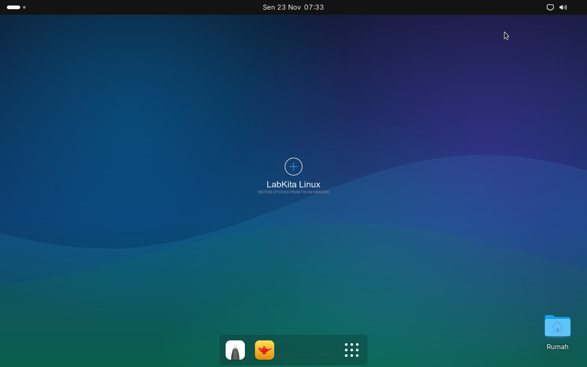
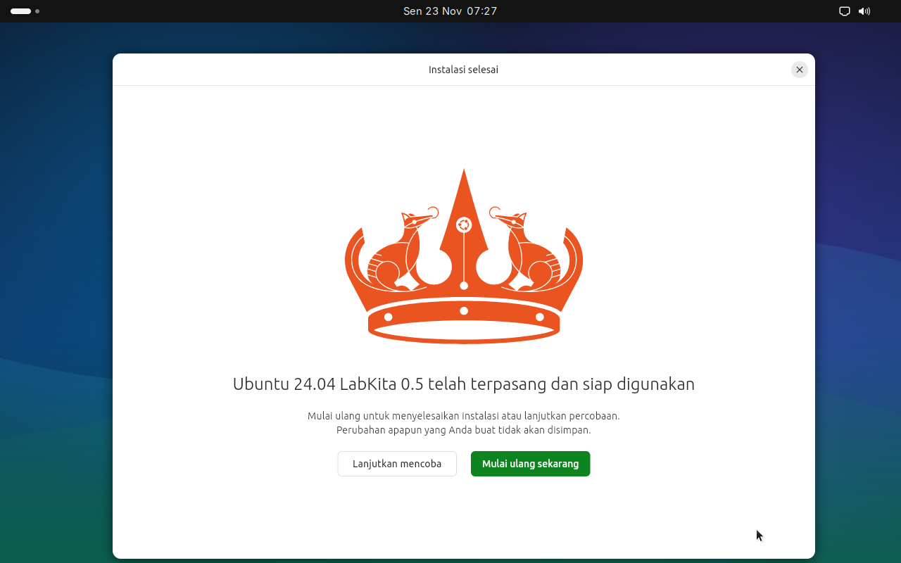
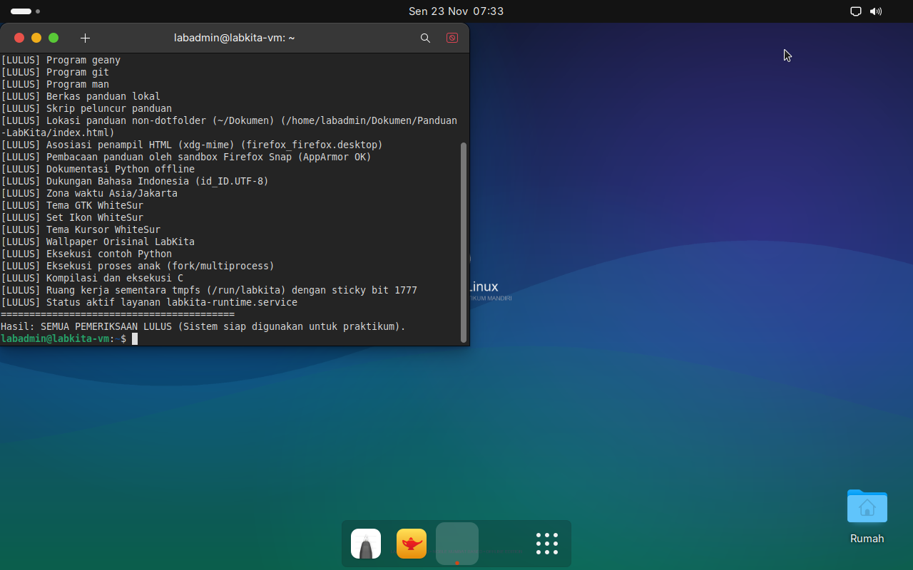
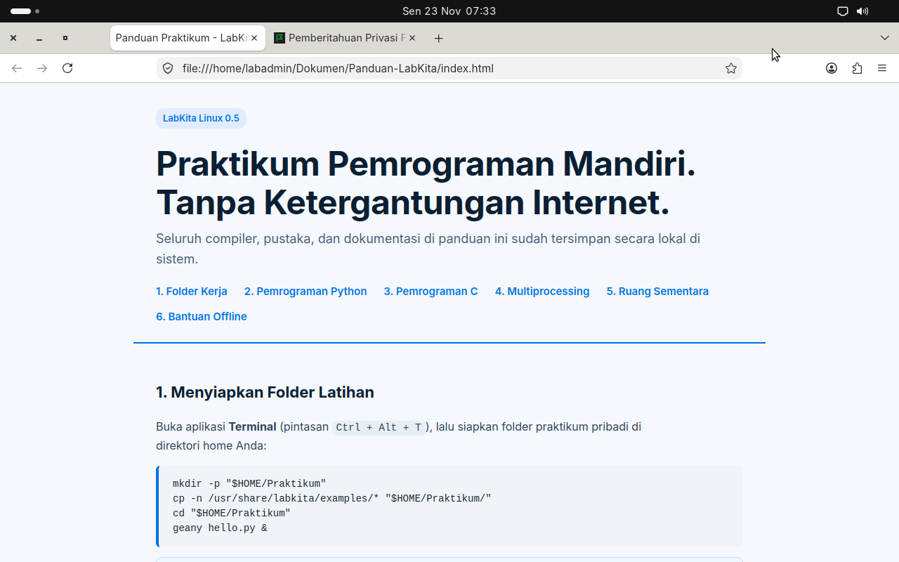
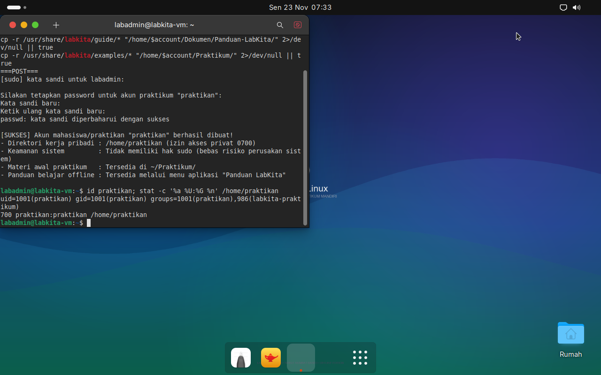

# LabKita Linux

**Distribusi Linux berbasis Ubuntu 24.04.5 LTS yang siap pakai untuk praktikum pemrograman dasar dan sistem operasi secara luring (*offline*).**

LabKita Linux dirancang agar komputer laboratorium dan mesin virtual dapat langsung digunakan sejak *booting* pertama tanpa ketergantungan koneksi internet—lengkap dengan *toolchain* C/C++ dan Python, panduan lokal ramah *sandbox*, antarmuka berbahasa Indonesia, serta isolasi akun praktikan.



---

## Unduhan & Verifikasi (Rilis Final 0.5)

**LabKita Linux 0.5 (`v0.5-iso`)** adalah versi final dan satu-satunya rilis resmi yang diunduh. *(Rilis `0.1`–`0.4` hanya disimpan dalam riwayat pengujian dan arsip checksum.)*

| Atribut | Detail |
| :--- | :--- |
| **Versi Final** | `0.5` (tag `v0.5-iso`) |
| **Basis Sistem** | Ubuntu 24.04.5 LTS Desktop (`x86_64` / `amd64`) |
| **Nama Berkas ISO** | `labkita-linux-0.5-amd64.iso` |
| **Ukuran Berkas** | `6.643.179.520 bytes` (~6,19 GiB) |
| **Tautan Unduhan** | [Unduh ISO di Google Drive](https://drive.google.com/drive/folders/10ZI4s-CYWAKA8GsHbTBCZm-p0QArp8lM?usp=sharing) |
| **SHA256** | `d0dae277d140decd3e1ecaff9b908c551109a10efd069b1472acd34b046f5f1c` |
| **MD5** | `b73178250b61cdfd900e3a3f8bdca660` |
| **Metode Build** | Script WSL reproducible [`tools/build_v05.py`](tools/build_v05.py) |

<details>
<summary>Cara verifikasi integritas berkas ISO (Windows &amp; Linux)</summary>

**Windows (PowerShell):**
```powershell
Get-FileHash -Algorithm SHA256 .\labkita-linux-0.5-amd64.iso
# D0DAE277D140DECD3E1ECAFF9B908C551109A10EFD069B1472ACD34B046F5F1C
```

**Linux / macOS (Bash):**
```bash
sha256sum labkita-linux-0.5-amd64.iso
# d0dae277d140decd3e1ecaff9b908c551109a10efd069b1472acd34b046f5f1c  labkita-linux-0.5-amd64.iso
```

</details>

---

## Tangkapan Layar

| Installer GUI Selesai Penuh | Pemeriksaan Sistem (`labkita-check`) |
| :---: | :---: |
|  |  |

| Panduan Offline di Firefox Snap | Pembuatan Akun Terisolasi (`labkita-postinstall`) |
| :---: | :---: |
|  |  |

---

## Fitur Utama

- **Toolchain Pemrograman Siap Luring:** Dilengkapi GCC 13.3.0, G++ 13.3.0, GNU Make 4.3, GDB, Python 3.12.3, Geany 2.0, Nano, Git 2.43, dan `manpages-dev`. Contoh kode dasar (`hello.c`, `hello.py`, `processes.py`) tersedia di `/usr/share/labkita/examples/`. *(Contoh tambahan `thread_demo.py` dan `memory_demo.c` ditambahkan di repositori pasca-rilis dan belum termasuk di ISO 0.5.)*
- **Antarmuka Modern & Lokalisasi Penuh:** Menggunakan tema sumber terbuka WhiteSur GTK/Icon/Cursors, font Inter, tombol jendela di kiri, dock bawah terpusat, wallpaper gradien LabKita, locale `id_ID.UTF-8`, dan zona waktu `Asia/Jakarta` tanpa aset proprietary.
- **Isolasi Akun Praktikan (`labkita-postinstall`):** Menyiapkan akun mahasiswa tanpa hak `sudo` di grup `labkita-praktikum` dengan izin direktori home ketat `0700`.
- **Workspace Temporer RAM (`tmpfs`):** Layanan `labkita-runtime.service` menyediakan `/run/labkita` berizin sticky bit `1777` untuk berkas sementara *(partisi `/run` bersifat `noexec`, sehingga kompilasi dan eksekusi biner C dilakukan dari `~/Praktikum`)*.
- **Panduan Ramah Sandbox & Diagnostik Mandiri:** `labkita-guide` menyalin dokumentasi HTML ke `~/Dokumen/Panduan-LabKita/` agar terbaca normal oleh Firefox Snap tanpa terblokir AppArmor; `labkita-check` memvalidasi seluruh komponen sistem termasuk tes baca langsung dari sandbox Firefox Snap.

---

## Panduan Penggunaan

### Spesifikasi Mesin Virtual Disarankan
- **Sistem Tamu:** Linux / Ubuntu (64-bit)
- **CPU & RAM:** Minimal 2 vCPU, 4 GB RAM (4096 MB)
- **Penyimpanan & Layar:** Minimal 25 GB disk kosong, resolusi 1280×800 atau lebih tinggi

### Menjalankan Sesi Live & Latihan
1. Pasang `labkita-linux-0.5-amd64.iso` pada VMware Workstation atau VirtualBox, lalu pilih **"Coba atau Pasang LabKita Linux 0.5 (Bahasa Indonesia)"** di GRUB.
2. Sistem otomatis login ke sesi live (`ubuntu`). Pilih *"Coba Ubuntu"* jika hanya ingin memakai mode live, atau lanjutkan installer grafis untuk memasang ke disk.
3. Jalankan perintah berikut di terminal (`Ctrl + Alt + T`) untuk memulai latihan:
   ```bash
   mkdir -p "$HOME/Praktikum"
   cp -n /usr/share/labkita/examples/* "$HOME/Praktikum/"
   cd "$HOME/Praktikum"

   python3 hello.py
   gcc -Wall -Wextra hello.c -o hello && ./hello
   labkita-check
   ```

### Instalasi ke Disk & Penyiapan Akun Praktikan
- **Prosedur Resmi (GUI):** Gunakan wizard grafis **Installer Ubuntu (`ubuntu-desktop-bootstrap`)** yang muncul saat live session hingga muncul dialog *"Instalasi selesai"*, lalu *restart*.
- **Prosedur Cadangan (TUI):** Apabila ingin memasang lewat mode teks:
  ```bash
  sudo snap run --shell ubuntu-desktop-bootstrap.subiquity-server -c "subiquity.cmd.tui"
  ```
- **Setelah instalasi selesai**, buat akun mahasiswa non-admin melalui:
  ```bash
  sudo labkita-postinstall praktikan
  ```

---

## Ringkasan Pengujian & Tolok Ukur Empiris

Pengujian fungsional dan pengukuran kinerja dilakukan di VM identik (2 vCPU, RAM 4096 MB / `3911 MiB` terbaca Linux, disk kosong 40 GB SCSI, `mks.enable3d = "FALSE"`). Rilis `0.5` lolos verifikasi `md5sum.txt` (`1016/1016 OK`), autologin `ubuntu`, instalasi GUI penuh, `labkita-check` (`AppArmor OK`), `labkita-postinstall`, serta 5 kali cold boot pengukuran kinerja.

| Versi (Riwayat Uji) | Metode Build | Kernel Terinstal | Rata-rata RAM (`free -m`) | Rata-rata Boot (`systemd-analyze`) | Catatan Status |
| :--- | :--- | :--- | :---: | :---: | :--- |
| **0.5 (Final)** | **WSL (`build_v05.py`)** | `7.0.0-43-generic` | `1.042,8 MiB` *(1.031–1.054)* | `9,036s` *(8,349–9,515s)* | **Lulus penuh (GUI resmi)** |
| **0.4** *(arsip)* | Cubic | `7.0.0-43-generic` | `1.062,6 MiB` *(1.043–1.075)* | `9,185s` *(8,520–10,713s)* | Autologin pulih; GUI gagal |
| **0.3** *(arsip)* | Cubic | `7.0.0-43-generic` | `1.058,2 MiB` *(1.046–1.067)* | `8,808s` *(8,460–9,014s)* | Lulus via TUI |
| **0.2** *(arsip)* | Cubic | `7.0.0-31-generic` | `1.068,2 MiB` *(1.058–1.080)* | `9,317s` *(9,072–9,458s)* | Lulus via TUI |
| **0.1** *(arsip)* | Cubic | `7.0.0-31-generic` | `1.038,2 MiB` *(1.016–1.056)* | `8,460s` *(8,359–8,676s)* | Lulus via TUI |

> **Catatan Analisis:** Rentang konsumsi RAM dan waktu boot `0.1`–`0.5` saling tumpang tindih serta terdapat perbedaan versi kernel (`7.0.0-31-generic` vs `7.0.0-43-generic`), sehingga **tidak ada perbedaan kinerja yang dapat dibuktikan** antarversi. Detail log uji, eksperimen kontrol (`bisect #1`–`#4`), serta perbaikan `.disk/info` dan line ending CRLF terdokumentasi lengkap di [`docs/TEST-PLAN.md`](docs/TEST-PLAN.md) dan [`docs/CONTROL-EXPERIMENT.md`](docs/CONTROL-EXPERIMENT.md).

---

## Struktur Repositori

```text
labkita-linux/
├── config/
│   └── packages.txt              # Daftar paket aplikasi & lokalisasi
├── dist/
│   ├── labkita-linux-0.5-amd64.iso.md5
│   ├── labkita-linux-0.5-amd64.iso.sha256
│   └── labkita-linux-0.1..0.4-amd64.iso.*   # Arsip checksum riwayat pengujian
├── docs/
│   ├── BUILD-CUBIC.md            # Catatan prosedur build arsip Cubic
│   ├── CONTRIBUTING.md           # Panduan alur kerja Git & kontribusi
│   ├── CONTROL-EXPERIMENT.md     # Log eksperimen kontrol, bisect, & root-cause
│   ├── CREDITS.md                # Atribusi lisensi tema, ikon, dan aset
│   ├── TEST-PLAN.md              # Matriks uji & benchmark 5x lengkap
│   ├── VM-BUILD.md               # Konfigurasi VM lingkungan pengembangan
│   └── evidence/                 # Tangkapan layar asli VM pengujian
├── payload/
│   ├── etc/                      # Konfigurasi dconf, locale, keyboard, & systemd
│   └── usr/                      # Skrip labkita-check, guide, postinstall, & modul latihan
├── scripts/
│   └── customize.sh              # Skrip kustomisasi chroot
└── tools/
    ├── build_v05.py              # Builder ISO 0.5 di WSL
    ├── pack.py                   # Pengemas arsip payload kustomisasi
    ├── generate_wallpaper.py     # Generator wallpaper gradien LabKita
    └── verify-linux.sh           # Validasi skrip & payload lokal
```

---

## Tim Pengembang & Lisensi

Dikembangkan oleh **Dafa Zahran**, **Rafly Fauzi Pratama**, **Muhammad Ilham Rizky**, dan **Vadien Athallah Lukman**. Panduan kontribusi kode tersedia di [`docs/CONTRIBUTING.md`](docs/CONTRIBUTING.md).

- Skrip dan konfigurasi LabKita dilisensikan di bawah [MIT License](LICENSE).
- Tema WhiteSur, font Inter, serta komponen sistem Ubuntu mengikuti lisensi proyek hulu masing-masing — rincian lengkap tercantum pada [`docs/CREDITS.md`](docs/CREDITS.md).
