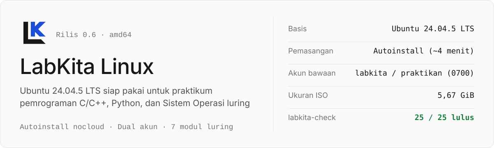
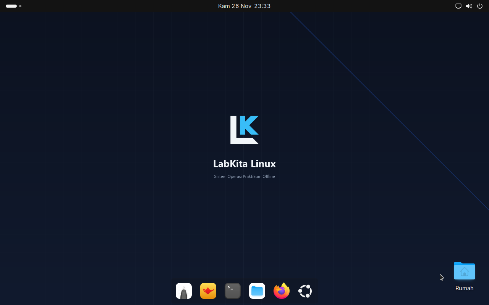
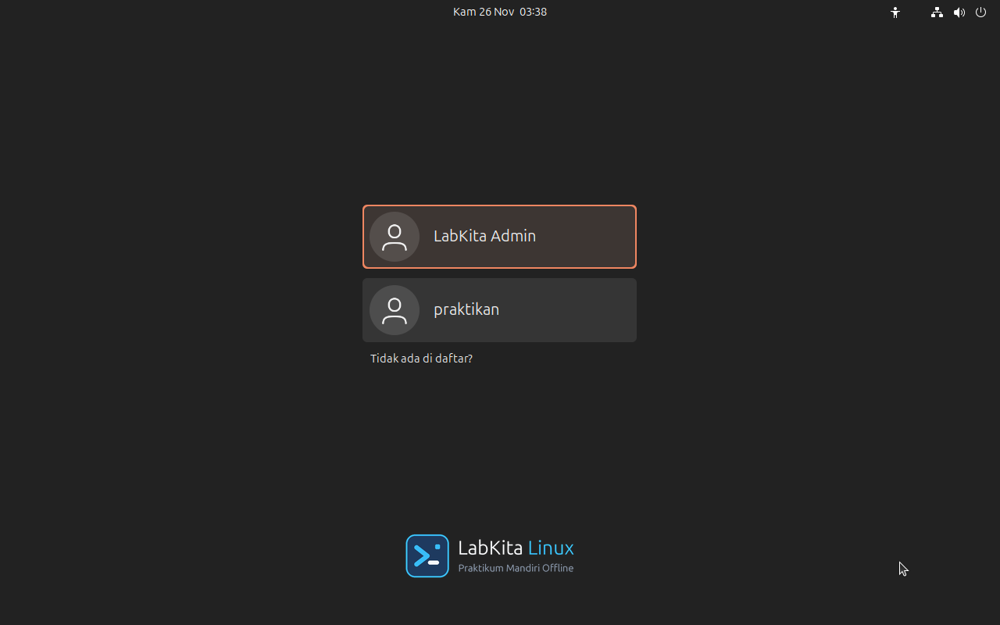
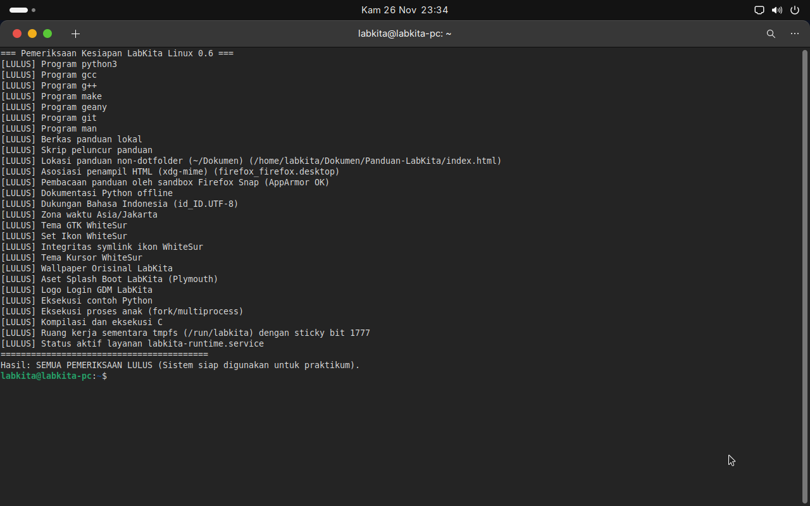
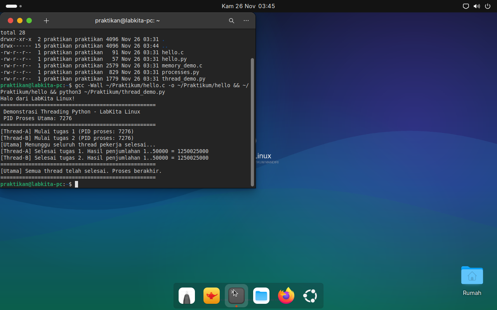
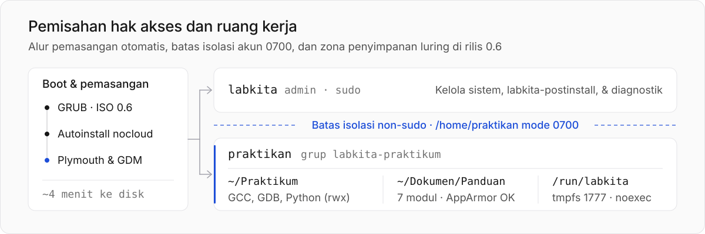

<p align="center">
  <picture>
    <source media="(prefers-color-scheme: dark)" srcset="./assets/readme/hero-dark.svg">
    <source media="(prefers-color-scheme: light)" srcset="./assets/readme/hero-light.svg">
    
  </picture>
</p>

<p align="center">
  <a href="#unduhan--verifikasi-iso-06">Unduh ISO 0.6</a>
  &nbsp;·&nbsp;
  <a href="#bukti-verifikasi-06">Tangkapan Layar</a>
  &nbsp;·&nbsp;
  <a href="#arsitektur-sistem">Arsitektur</a>
  &nbsp;·&nbsp;
  <a href="#mulai-cepat-di-vmware--virtualbox">Panduan VMware</a>
  &nbsp;·&nbsp;
  <a href="docs/TEST-PLAN.md">Laporan Uji 0.6</a>
</p>

**LabKita Linux** adalah distro Linux berbasis **Ubuntu 24.04.5 LTS** untuk praktikum pemrograman dasar tanpa internet, dilengkapi Python, GCC, editor kode Geany, dan dokumentasi *offline*.

Satu kali pemasangan otomatis menghasilkan sistem desktop berbahasa Indonesia lengkap dengan pemisahan akun admin/mahasiswa, *toolchain* C/C++ dan Python, identitas grafis resmi **Keystone LK**, serta buku kerja interaktif 7 modul.

---

## Bukti Verifikasi 0.6

Seluruh tangkapan layar berikut diambil langsung dari pengujian instalasi penuh `labkita-linux-0.6-amd64.iso` pada VMware Workstation:

| Desktop LabKita Linux 0.6 | Layar Login GDM (Keystone LK + Dual Akun) |
| :---: | :---: |
|  |  |

| Buku Kerja 7 Modul (Firefox Snap AppArmor OK) | Diagnostik Mandiri (`labkita-check` 25/25 Lulus) |
| :---: | :---: |
|  |  |

| App Grid & Ikon WhiteSur Lengkap | Akun `praktikan` (`0700`) & Kompilasi Luring |
| :---: | :---: |
|  |  |

---

## Mengapa LabKita Linux

- **Autoinstall Nol-Langkah (`nocloud`):** Memasang sistem ke disk secara otomatis dalam ~4 menit tanpa wizard panjang maupun kendala render dialog akun pada VM. Entri manual dan *Safe Graphics* tetap tersedia di menu GRUB.
- **Pemisahan Akun Admin & Mahasiswa:** Akun **`labkita`** (`sudo`) disiapkan untuk asisten/pengelola lab, sedangkan **`praktikan`** berada pada grup `labkita-praktikum` tanpa hak `sudo` dengan direktori privat `/home/praktikan` mode `0700`. *(Ganti kata sandi default sebelum dipakai di lingkungan terbuka.)*
- **Toolchain Luring & Pembersihan Bloat Aman:** Tersedia `gcc`/`g++` 13.3.0, GNU Make 4.3, GDB, Python 3.12.3, Geany 2.0, Nano, Git 2.43, `manpages-dev`, dan `python3-doc`. Paket hiburan/kantor yang tidak diperlukan dibersihkan via [`config/remove-packages.txt`](config/remove-packages.txt) dengan guard proteksi paket desktop inti.
- **Buku Kerja 7 Modul Ramah Sandbox & `tmpfs`:** Perintah `labkita-guide` menyalin [`payload/usr/share/labkita/guide/index.html`](payload/usr/share/labkita/guide/index.html) ke `~/Dokumen/Panduan-LabKita/` agar terbaca langsung oleh Firefox Snap tanpa blokir AppArmor. Layanan `labkita-runtime.service` menyediakan `/run/labkita` (`tmpfs` mode `1777`, `noexec`).

---

## Arsitektur Sistem

<p align="center">
  <picture>
    <source media="(prefers-color-scheme: dark)" srcset="./assets/readme/architecture-dark.svg">
    <source media="(prefers-color-scheme: light)" srcset="./assets/readme/architecture-light.svg">
    
  </picture>
</p>

| Komponen | Lokasi di Sistem Terpasang | Fungsi Utama |
| :--- | :--- | :--- |
| **Autoinstall & Branding** | `nocloud/user-data`, `/usr/share/plymouth/`, `/usr/share/pixmaps/` | Pemasangan otomatis, logo **Keystone LK** di Plymouth/GDM, wallpaper **Cobalt Architectural Slate** |
| **Akun & Isolasi** | `labkita` (`sudo`), `praktikan` (`labkita-praktikum`, `0700`) | Memisahkan wewenang administrasi asisten dari ruang kerja mahasiswa (`labkita-postinstall`) |
| **Toolchain & Contoh** | `~/Praktikum/`, `gcc`, `gdb`, `python3`, `geany` | Latihan pemrograman C, manajemen proses (`fork`), multithreading, dan memori luring |
| **Diagnostik & Panduan** | [`labkita-check`](payload/usr/local/bin/labkita-check), [`labkita-guide`](payload/usr/local/bin/labkita-guide) | Verifikasi kesiapan lab 25 poin serta buku kerja interaktif 7 modul + checklist `localStorage` |

---

## Unduhan & Verifikasi ISO 0.6

| Atribut | Detail Rilis `0.6` (`v0.6-iso`) |
| :--- | :--- |
| **Basis Sistem** | Ubuntu 24.04.5 LTS Desktop (`x86_64` / `amd64`) |
| **Nama Berkas ISO** | `labkita-linux-0.6-amd64.iso` |
| **Ukuran Berkas** | `6.083.305.472 bytes` (~5,67 GiB) |
| **Tautan Unduhan** | [Unduh ISO 0.6 di Google Drive](https://drive.google.com/file/d/1RDzopdN0bBrd8b0lgcdtbKWmOZcizxIV/view?usp=sharing) |
| **SHA256** | `78a58f0f757b63b97b46e21a520a2c2ea7a205458119192c8f4ed10d2fe9bde1` ([`.sha256`](dist/labkita-linux-0.6-amd64.iso.sha256)) |
| **MD5** | `7db00f4c1bfbdf06df62c77bfd0e14c7` ([`.md5`](dist/labkita-linux-0.6-amd64.iso.md5)) |

<details>
<summary>Verifikasi hash integritas ISO di Windows (PowerShell) dan Linux/macOS (Bash)</summary>

**Windows (PowerShell):**
```powershell
Get-FileHash -Algorithm SHA256 .\labkita-linux-0.6-amd64.iso
# Harus cocok: 78A58F0F757B63B97B46E21A520A2C2EA7A205458119192C8F4ED10D2FE9BDE1
```

**Linux / macOS (Bash):**
```bash
sha256sum -c dist/labkita-linux-0.6-amd64.iso.sha256
```

</details>

*(Arsip build rilis sebelumnya tersedia pada riwayat tag Git `v0.4-iso` dan `v0.5-iso`.)*

---

## Mulai Cepat di VMware & VirtualBox

**Spesifikasi VM Disarankan:** Linux Ubuntu 64-bit, minimal 2 vCPU, RAM 4 GB (`4096 MB`), ruang disk kosong 25 GB (disarankan 40 GB), resolusi layar `1280x800` atau lebih tinggi.

1. Pasang `labkita-linux-0.6-amd64.iso` pada VM dan biarkan entri GRUB default **"Pasang Otomatis LabKita Linux 0.6 (Admin + Praktikan)"** menyelesaikan instalasi (~4 menit).
2. Setelah masuk layar login **GDM**, pilih **praktikan** (sandi default: `praktikan`) untuk mahasiswa atau **LabKita Admin** (`labkita` / `labkita`) untuk pengelola lab.
3. Buka Terminal (`Ctrl + Alt + T`), jalankan panduan dan verifikasi cepat:
   ```bash
   labkita-guide
   cd "$HOME/Praktikum"
   python3 hello.py
   gcc -Wall -Wextra hello.c -o hello && ./hello
   labkita-check
   ```

> [!IMPORTANT]
> **Pengaturan Penting VMware Workstation:**
> - Saat membuat VM baru, pilih **"I will install the operating system later."** lalu arahkan ISO melalui *Customize Hardware -> CD/DVD (SATA)* agar fitur *Easy Install* VMware tidak menimpa seed `autoinstall` `nocloud` LabKita.
> - Setelah instalasi selesai dan reboot ke disk, matikan **Connect at power on** pada CD/DVD serta aktifkan **Display -> Accelerate 3D graphics**. Jika layar hitam masih muncul setelah login di host tertentu, klik ikon gerigi kanan bawah pada layar login GDM lalu pilih **Ubuntu on Xorg**.

---

## Reproduksi Build & Validasi Lokal

Seluruh pembangunan ISO `0.6` dijalankan di WSL/Linux menggunakan [`tools/build_v06.py`](tools/build_v06.py) di atas berkas ISO resmi Ubuntu 24.04.5 LTS Desktop:

```bash
# Validasi sintaks skrip, contoh program, dan unit systemd tanpa root
bash tools/verify-linux.sh

# Bangun ulang ISO LabKita Linux 0.6 di WSL/Linux
sudo python3 tools/build_v06.py \
  --source-iso /path/ke/ubuntu-24.04.5.1-desktop-amd64.iso \
  --output-iso build/labkita-linux-0.6-amd64.iso
```

---

## Struktur Repositori

```text
labkita-linux/
├── assets/
│   ├── brand/                    # SVG & PNG logo Keystone LK dan wordmark resmi
│   └── readme/                   # Aset visual hero & arsitektur README (light/dark SVG)
├── config/
│   ├── packages.txt              # Daftar paket toolchain & lokalisasi luring
│   └── remove-packages.txt       # Daftar pembersihan bloat aman berproteksi
├── dist/
│   └── labkita-linux-0.6-amd64.iso.{md5,sha256}
├── docs/
│   ├── CONTRIBUTING.md           # Alur kerja Git & konvensi tim
│   ├── CREDITS.md                # Lisensi & atribusi komponen sumber terbuka
│   ├── QA-CHECKLIST.md           # Daftar cek QA & evaluasi keamanan 0.6
│   ├── TEST-PLAN.md              # Hasil verifikasi nyata VMware rilis 0.6
│   └── evidence/                 # Tangkapan layar verifikasi VMware 0.6
├── payload/
│   ├── etc/                      # dconf (desktop & GDM), skel, & labkita-runtime.service
│   └── usr/                      # Skrip labkita-*, tema WhiteSur, ikon, & buku kerja HTML
└── tools/
    ├── build_v06.py              # Pipeline pembangun ISO 0.6 (autoinstall nocloud)
    ├── generate_brand_assets.py  # Generator logo Plymouth & GDM dari SVG resmi
    ├── generate_wallpaper.py     # Generator wallpaper Cobalt Architectural Slate
    └── verify-linux.sh           # Validasi sintaks & unit systemd lokal
```

---

## Tim Pengembang & Lisensi

Dikembangkan oleh **Dafa Zahran**, **Rafly Fauzi Pratama**, **Muhammad Ilham Rizky**, dan **Vadien Athallah Lukman**. Panduan kontribusi kode tersedia di [`docs/CONTRIBUTING.md`](docs/CONTRIBUTING.md) dan catatan verifikasi lengkap di [`docs/TEST-PLAN.md`](docs/TEST-PLAN.md).

- Skrip dan konfigurasi LabKita dilisensikan di bawah [MIT License](LICENSE).
- Tema WhiteSur, font Inter, serta paket sistem Ubuntu mengikuti lisensi proyek hulu masing-masing; rincian tercantum di [`docs/CREDITS.md`](docs/CREDITS.md).
