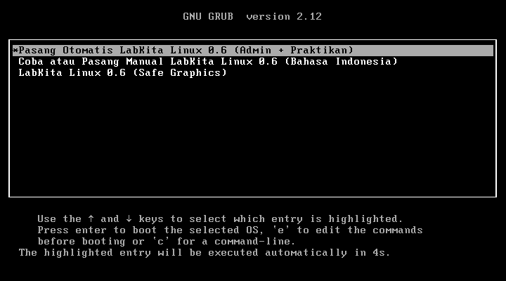
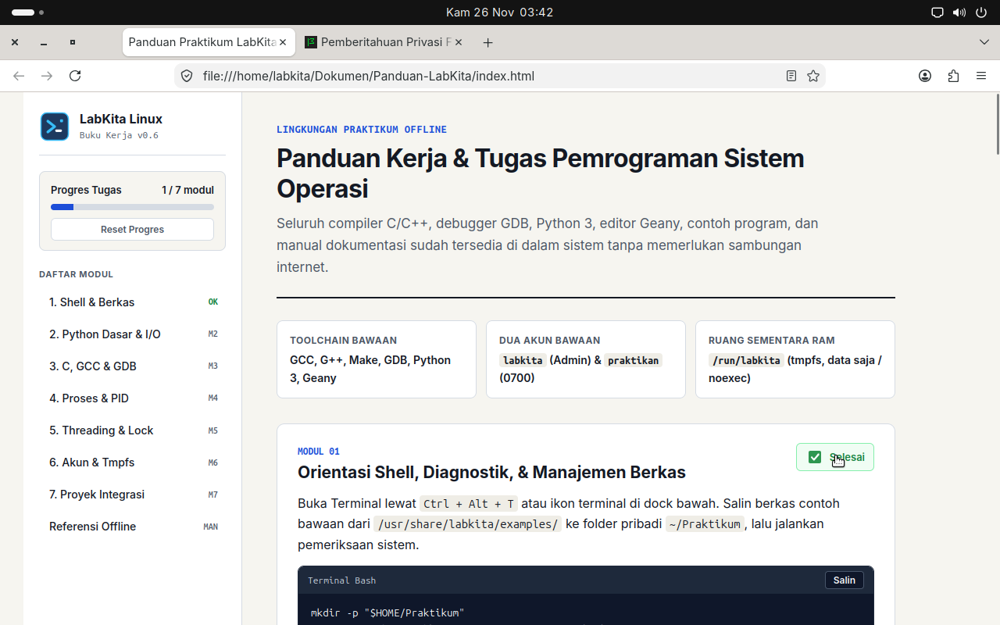
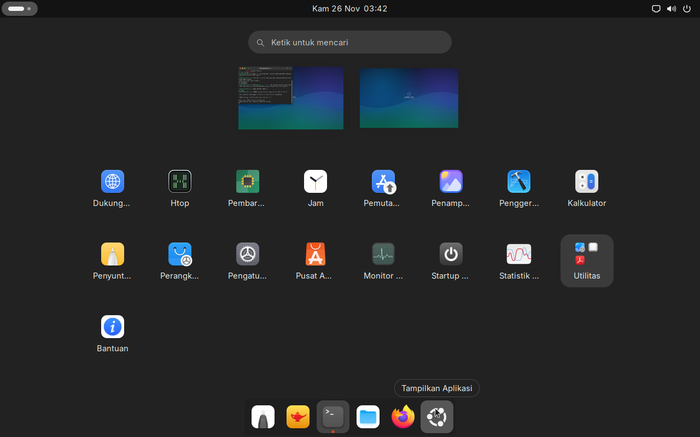

<p align="center">
  <picture>
    <source media="(prefers-color-scheme: dark)" srcset="assets/brand/labkita-wordmark-dark.svg">
    <source media="(prefers-color-scheme: light)" srcset="assets/brand/labkita-wordmark-light.svg">
    
  </picture>
</p>

# LabKita Linux

**Distribusi Linux berbasis Ubuntu 24.04.5 LTS yang siap pakai untuk praktikum pemrograman dasar dan sistem operasi secara luring (*offline*).**

LabKita Linux dirancang agar komputer laboratorium dan mesin virtual dapat dipasang tanpa langkah wizard panjang dan langsung dipakai dengan dua akun siap guna (`labkita` untuk admin/asisten dan `praktikan` terisolasi non-`sudo` untuk mahasiswa), lengkap dengan *toolchain* C/C++ & Python, logo merek resmi di splash boot maupun layar login GDM, serta buku kerja praktikum 7 modul ramah sandbox Firefox Snap.


---

## Unduhan & Verifikasi (Rilis 0.6 & Rilis Dasar 0.5)

### Rilis 0.6 (Autoinstall, Dual Akun Bawaan, & Branding Lengkap)

| Atribut | Detail |
| :--- | :--- |
| **Versi** | `0.6` (cabang `feat/v06-autoinstall-brand`) |
| **Basis Sistem** | Ubuntu 24.04.5 LTS Desktop (`x86_64` / `amd64`) |
| **Nama Berkas ISO** | `labkita-linux-0.6-amd64.iso` |
| **Ukuran Berkas** | `6.083.645.440 bytes` (~5,67 GiB) |
| **SHA256** | `6a9a055b2833e3ef64e4633db81c061992a73ba4ae91f599c45b9943fdfcd115` |
| **MD5** | `0dd73d162837435295dda31b0e901652` |
| **Metode Build** | Script WSL [`tools/build_v06.py`](tools/build_v06.py) (tanpa bloat `minimal.standard`, dengan `nocloud` autoinstall) |

<details>
<summary>Cara verifikasi integritas berkas ISO 0.6 (Windows &amp; Linux)</summary>

**Windows (PowerShell):**
```powershell
Get-FileHash -Algorithm SHA256 .\labkita-linux-0.6-amd64.iso
# 6A9A055B2833E3EF64E4633DB81C061992A73BA4AE91F599C45B9943FDFCD115
```

**Linux / macOS (Bash):**
```bash
sha256sum labkita-linux-0.6-amd64.iso
# 6a9a055b2833e3ef64e4633db81c061992a73ba4ae91f599c45b9943fdfcd115  labkita-linux-0.6-amd64.iso
```

</details>

### Arsip Rilis Dasar 0.5 (`v0.5-iso`)

| Atribut | Detail |
| :--- | :--- |
| **Versi Dasar** | `0.5` (tag `v0.5-iso` di `main`) |
| **Nama Berkas ISO** | `labkita-linux-0.5-amd64.iso` (`6.643.179.520 bytes` / ~6,19 GiB) |
| **Tautan Unduhan** | [Unduh ISO 0.5 di Google Drive](https://drive.google.com/drive/folders/10ZI4s-CYWAKA8GsHbTBCZm-p0QArp8lM?usp=sharing) |
| **SHA256 / MD5** | `d0dae277d140decd3e1ecaff9b908c551109a10efd069b1472acd34b046f5f1c` / `b73178250b61cdfd900e3a3f8bdca660` |

*(Rilis `0.1`-`0.4` hanya disimpan dalam arsip checksum pengujian pada folder `dist/`.)*

---

## Tangkapan Layar Verifikasi 0.6

| GRUB Autoinstall Nol-Langkah | Layar Login GDM (Logo LabKita + Dual Akun) |
| :---: | :---: |
|  |  |

| Buku Kerja Praktikum 7 Modul (Firefox Snap) | Pemeriksaan Sistem (`labkita-check`) |
| :---: | :---: |
|  |  |

| App Grid &amp; Ikon WhiteSur Lengkap | Akun `praktikan` Non-Sudo &amp; Kompilasi Luring |
| :---: | :---: |
|  |  |

---

## Fitur Utama (0.6)

- **Autoinstall Nol-Langkah (`nocloud`):** Memasang sistem ke disk secara otomatis tanpa melalui dialog panjang installer ataupun bug render kotak abu-abu OpenGL VMware pada pembuatan akun. Entri manual dan *Safe Graphics* tetap tersedia di menu GRUB sebagai opsi cadangan.
- **Dual Akun Siap Pakai Saat Pertama Boot:**
  - `labkita` (password default: `labkita`) sebagai administrator (`sudo`), tanpa popup GNOME Initial Setup atau notifikasi upgrade rilis.
  - `praktikan` (password default: `praktikan`) sebagai akun mahasiswa non-`sudo` di grup `labkita-praktikum` dengan direktori privat `/home/praktikan` mode `0700` dan salinan awal `~/Praktikum`. *(Ganti kata sandi default sebelum dipakai di lingkungan publik.)*
- **Identitas Resmi LabKita &amp; Pemulihan Ikon WhiteSur:** Logo terminal geometris [`assets/brand/`](assets/brand/) terpasang pada splash boot **Plymouth** serta layar masuk **GDM** via `dconf`. Ekstraksi tar menjaga keutuhan symlink ikon WhiteSur serta menjalankan `gtk-update-icon-cache` sehingga seluruh ikon Dock, App Grid, dan Pengaturan tampil penuh.
- **Toolchain Luring &amp; Penghapusan Bloat Aman:** Dilengkapi GCC/G++ 13.3.0, GNU Make 4.3, GDB, Python 3.12.3, Geany 2.0, Nano, Git 2.43, `manpages-dev`, serta `python3-doc`. Paket hiburan/kantor yang tidak diperlukan dan `unattended-upgrades` dibersihkan lewat [`config/remove-packages.txt`](config/remove-packages.txt) dengan guard proteksi paket desktop inti.
- **Buku Kerja Praktikum 7 Modul Ramah Sandbox:** `labkita-guide` menyalin [`payload/usr/share/labkita/guide/index.html`](payload/usr/share/labkita/guide/index.html) ke `~/Dokumen/Panduan-LabKita/` agar terbaca normal oleh Firefox Snap tanpa terblokir AppArmor. Materi mencakup 7 modul (Shell, Python I/O, C/GCC/GDB, Proses/PID, Threading/Lock, Akun/`tmpfs`, dan Proyek Integrasi), tombol salin perintah, dan pelacak progres `localStorage`.
- **Workspace Temporer RAM (`tmpfs`):** Layanan `labkita-runtime.service` menyediakan `/run/labkita` berizin sticky bit `1777` untuk data sementara *(partisi `/run` bersifat `noexec`, sehingga kompilasi dan eksekusi biner C dilakukan dari `~/Praktikum`)*.

---

## Panduan Penggunaan

### Spesifikasi Mesin Virtual Disarankan
- **Sistem Tamu:** Linux / Ubuntu (64-bit)
- **CPU &amp; RAM:** Minimal 2 vCPU, 4 GB RAM (`4096 MB`)
- **Penyimpanan &amp; Layar:** Minimal 25 GB disk kosong (direkomendasikan 40 GB), resolusi 1280x800 atau lebih tinggi

### Instalasi Otomatis &amp; Mulai Praktikum
1. Pasang `labkita-linux-0.6-amd64.iso` pada VMware Workstation atau VirtualBox, lalu biarkan menu GRUB default **"Pasang Otomatis LabKita Linux 0.6 (Admin + Praktikan)"** berjalan (sekitar 4 menit).
2. Setelah sistem selesai memasang dan masuk ke layar login GDM, pilih **praktikan** (`praktikan`) untuk mahasiswa atau **LabKita Admin** (`labkita` / `labkita`) untuk asisten.
3. Buka panduan di browser dengan mengetik `labkita-guide` di Terminal (`Ctrl + Alt + T`), lalu uji contoh praktikum:
   ```bash
   cd "$HOME/Praktikum"
   python3 hello.py
   python3 thread_demo.py
   gcc -Wall -Wextra hello.c -o hello && ./hello
   labkita-check
   ```

---

## Ringkasan Pengujian &amp; Tolok Ukur Empiris

Pengujian verifikasi `0.6` berjalan nyata di VMware Workstation (`40 GB` disk kosong, `6144 MB` RAM / `5921 MiB` terbaca Linux, 2 vCPU, NIC NAT terhubung): autoinstall tuntas dalam ~4 menit, layar GDM menampilkan logo LabKita serta kedua akun, desktop bersih tanpa dialog sambutan, seluruh ikon tampil utuh, isolasi akun `praktikan` (`0700`, non-`sudo`) terkonfirmasi, serta `labkita-check` lulus penuh. Pada satu observasi pasca-autoinstall di VM 6 GB RAM tersebut tercatat penggunaan `free -m` `1.114 MiB` (avail `4.806 MiB`), `systemd-analyze` `22,207s`, dan penggunaan rootfs `11 GB / 40 GB`.

Untuk riwayat benchmark komparatif `0.1`-`0.5` yang terstandarisasi pada **VM uji identik 4 GB RAM (`3911 MiB`)** dengan **5 kali cold boot per versi**:

| Versi (Riwayat Uji) | Metode Build | Kernel Terinstal | Rata-rata RAM (`free -m`) | Rata-rata Boot (`systemd-analyze`) | Catatan Status |
| :--- | :--- | :--- | :---: | :---: | :--- |
| **0.5** *(basis rilis)* | WSL (`build_v05.py`) | `7.0.0-43-generic` | `1.042,8 MiB` *(1.031-1.054)* | `9,036s` *(8,349-9,515s)* | Lulus penuh (GUI manual resmi) |
| **0.4** *(arsip)* | Cubic | `7.0.0-43-generic` | `1.062,6 MiB` *(1.043-1.075)* | `9,185s` *(8,520-10,713s)* | Autologin pulih; GUI gagal |
| **0.3** *(arsip)* | Cubic | `7.0.0-43-generic` | `1.058,2 MiB` *(1.046-1.067)* | `8,808s` *(8,460-9,014s)* | Lulus via TUI |
| **0.2** *(arsip)* | Cubic | `7.0.0-31-generic` | `1.068,2 MiB` *(1.058-1.080)* | `9,317s` *(9,072-9,458s)* | Lulus via TUI |
| **0.1** *(arsip)* | Cubic | `7.0.0-31-generic` | `1.038,2 MiB` *(1.016-1.056)* | `8,460s` *(8,359-8,676s)* | Lulus via TUI |

> **Catatan Analisis:** Pengukuran `0.6` dilakukan pada VM 6 GB RAM pasca-autoinstall (1x observasi), sedangkan seri `0.1`-`0.5` diukur 5x cold boot pada VM 4 GB RAM, sehingga tidak diklaim lebih cepat/hemat antarversi. Detail log eksperimen awal terdokumentasi di [`docs/TEST-PLAN.md`](docs/TEST-PLAN.md) dan [`docs/CONTROL-EXPERIMENT.md`](docs/CONTROL-EXPERIMENT.md).

---

## Struktur Repositori

```text
labkita-linux/
├── assets/
│   └── brand/                    # SVG & PNG marka dan wordmark resmi LabKita Linux
├── config/
│   ├── packages.txt              # Daftar paket toolchain & lokalisasi luring
│   └── remove-packages.txt       # Daftar pembersihan bloat aman (dengan guard proteksi)
├── dist/
│   ├── labkita-linux-0.6-amd64.iso.*   # Checksum SHA256 & MD5 rilis 0.6
│   └── labkita-linux-0.1..0.5-amd64.iso.*   # Arsip checksum rilis terdahulu
├── docs/
│   └── evidence/                 # Tangkapan layar nyata pengujian VMware (0.3-0.6)
├── payload/
│   ├── etc/                      # dconf (desktop & GDM), skel, locale, & systemd
│   └── usr/                      # Skrip labkita-check, guide, postinstall, ikon WhiteSur, & buku kerja HTML
├── scripts/
│   └── customize.sh              # Skrip kustomisasi chroot
└── tools/
    ├── build_v06.py              # Builder ISO 0.6 di WSL (Autoinstall nocloud + branding)
    ├── build_v05.py              # Builder ISO 0.5 di WSL (tag v0.5-iso)
    ├── generate_brand_assets.py  # Generator aset logo Plymouth, GDM, dan README
    └── verify-linux.sh           # Validasi skrip & payload lokal
```

---

## Tim Pengembang & Lisensi

Dikembangkan oleh **Dafa Zahran**, **Rafly Fauzi Pratama**, **Muhammad Ilham Rizky**, dan **Vadien Athallah Lukman**. Panduan kontribusi kode tersedia di [`docs/CONTRIBUTING.md`](docs/CONTRIBUTING.md).

- Skrip dan konfigurasi LabKita dilisensikan di bawah [MIT License](LICENSE).
- Tema WhiteSur, font Inter, serta komponen sistem Ubuntu mengikuti lisensi proyek hulu masing-masing; rincian lengkap tercantum pada [`docs/CREDITS.md`](docs/CREDITS.md).
